# Career Compass

**English** | [中文](README.zh-CN.md)

**Explore Shanghai careers through places, skills and university courses.**

Career Compass helps computing students explore the connection between university study and potential careers in Shanghai. It brings company locations, recorded technology roles, skills and course information into one place, with an interactive browser map and a Python terminal interface.

### The problem

Students may know which courses they have studied but find it difficult to understand how those courses relate to the skills mentioned in real job descriptions. Recruitment information is scattered across company websites, and it can also be hard to see where different employers are located or compare opportunities by area. Career Compass brings these pieces together as a starting point for exploration, rather than treating a course match as proof of job readiness.

### Why Shanghai?

Shanghai is one of China's most developed cities, with a wide range of industries and major employers that may offer opportunities for computing graduates. Its international connections and diverse business community make it a useful city to explore for international students and Chinese students returning from overseas. Individual opportunities, eligibility and experiences vary.

### How it helps

Start with the map to discover companies and their recorded roles by location, or start with courses to explore roles connected through documented skill mappings. Role details include source links where available, so users can check the original information. The Python analysis also helps compare a user's self-reported skills with those recorded for a role and suggests related courses.

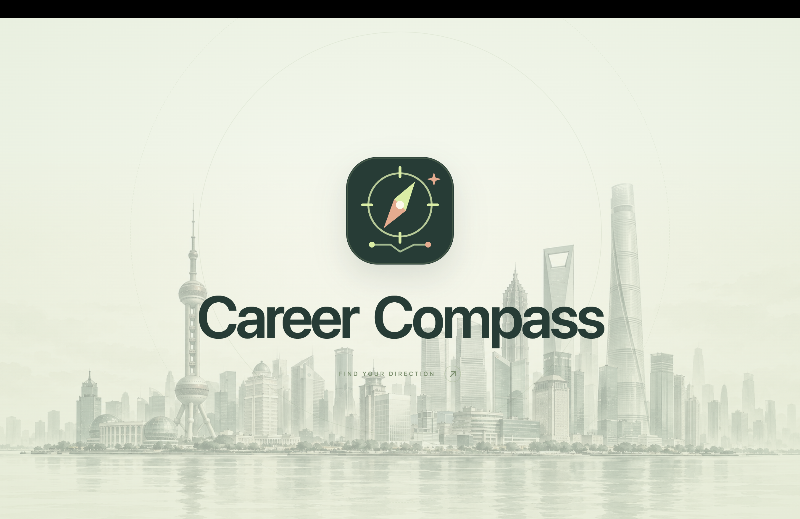

## Explore Shanghai

Browse the city map, choose a district and explore company locations and recorded roles. Nearby companies can expand into an interactive galaxy of logos; markers distinguish companies with role records from company-only entries.

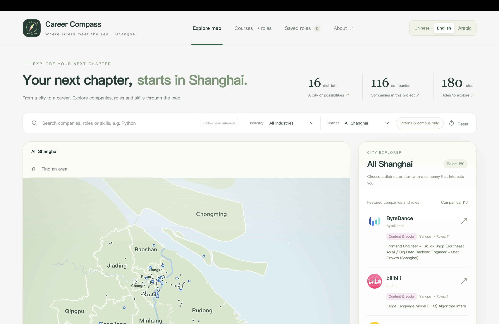
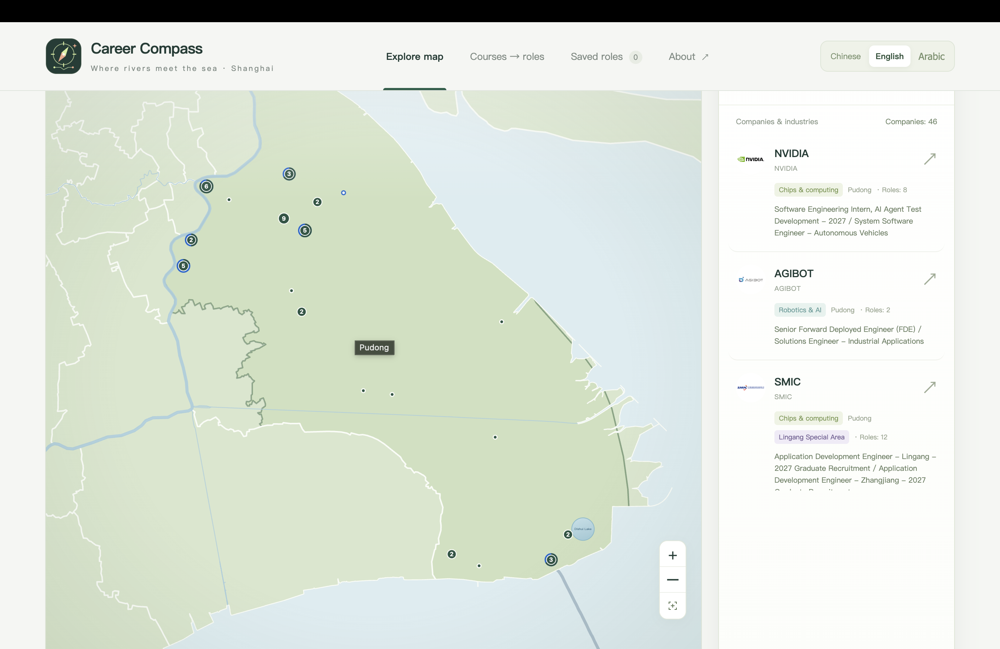
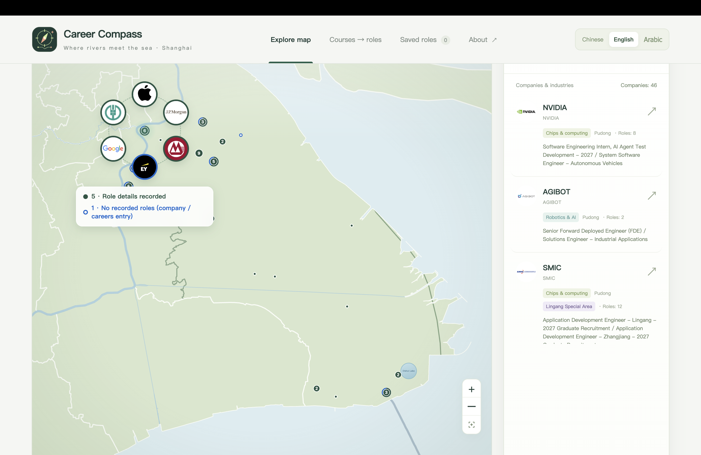

**Map legend:** Green identifies a company with recorded role details; blue identifies a company or careers entry without a recorded role; a mixed marker contains both. Numbers indicate grouped nearby companies at the current zoom level. The expanded galaxy shows the same status around each logo.

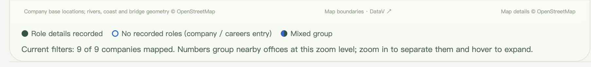
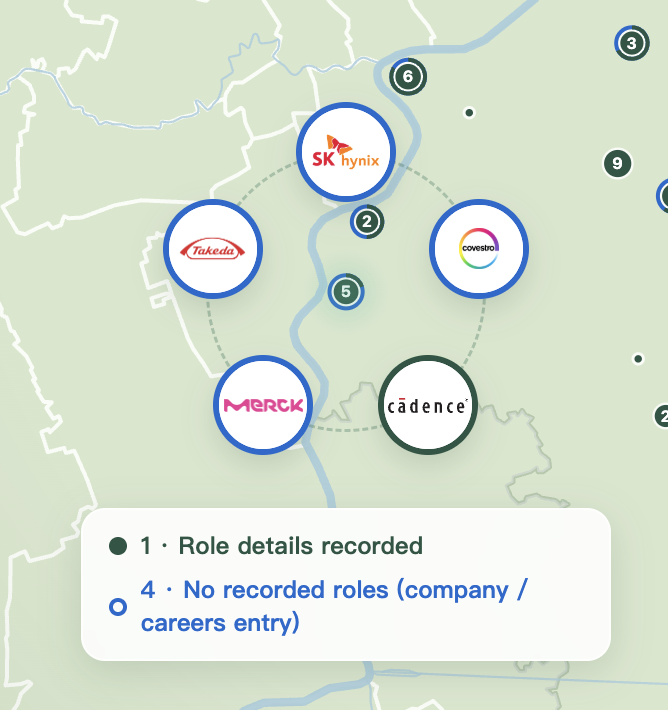

## Browse districts, companies and roles

Explore searchable directories of Shanghai districts, companies and recorded roles. Select an entry to continue exploring its information.

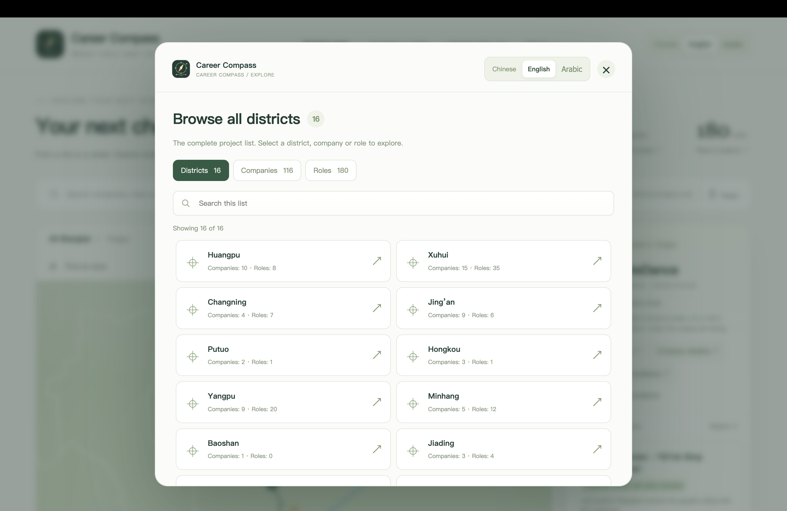
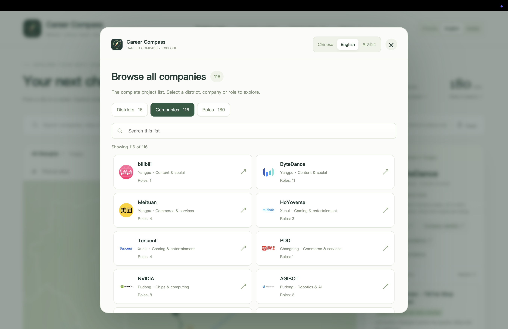
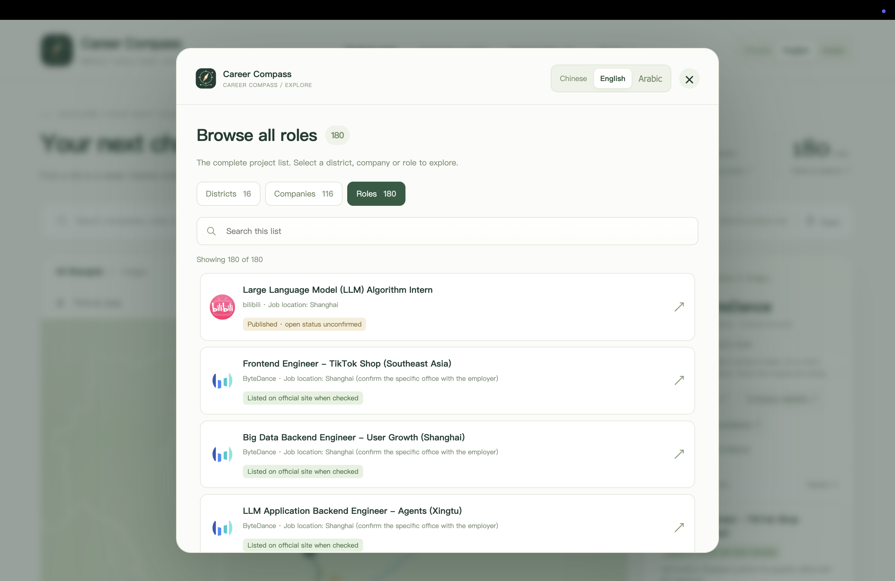

## Explore a role

Open a role to see its recorded location, hiring status, source information, skills and an indicative company location. Follow the original listing to check current details; a company map marker is not a confirmed workplace for every role.

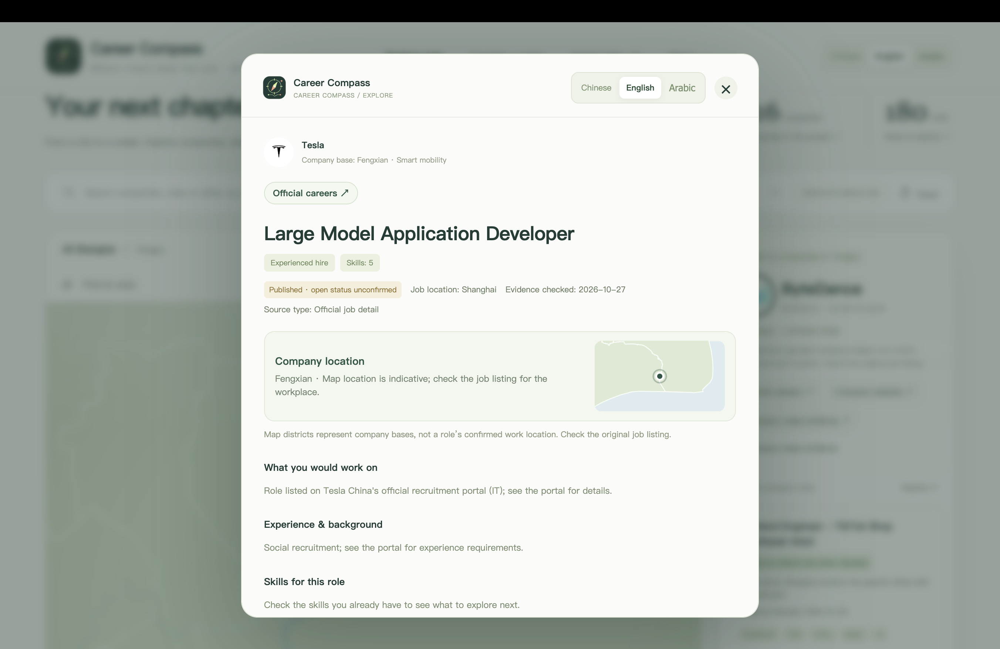

*These screenshots show an earlier data snapshot. Counts and individual records may change as locations and sources are reviewed.*

## Connect courses and careers

Select courses to explore related roles and the skills connecting them. The six-direction course profile visualises course coverage; click a direction to filter its related courses.

- **Milestones:** When selecting one more course brings the total to a multiple of five (5, 10, 15 and so on), a brief milestone animation appears. Milestone 1 means five courses selected; Milestone 2 means ten.
- **Hexagon Ranger:** Unlock the gold six-sided achievement when each of the six directions has at least three related selected courses. A course related to more than one direction contributes to each relevant direction, so this does not necessarily require 18 different courses. Unlocking counts related courses; it does not require three weighted points per direction. The course filter separately shows core relevance (+1) and supporting relevance (+0.5).
- **What it means:** Both are course-exploration features. They describe selections and course relationships, not proven skills or eligibility.

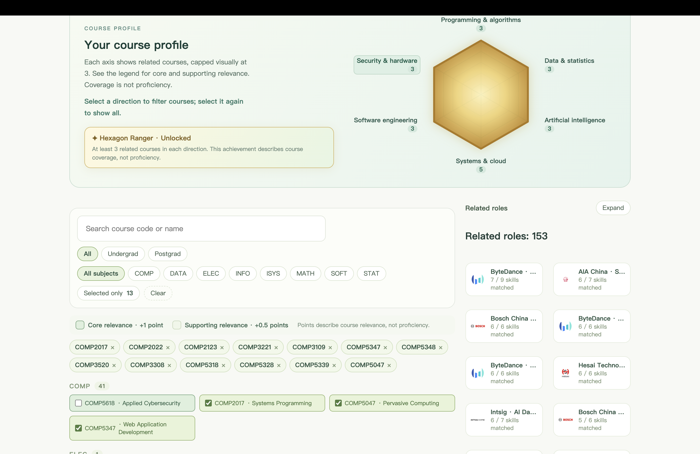
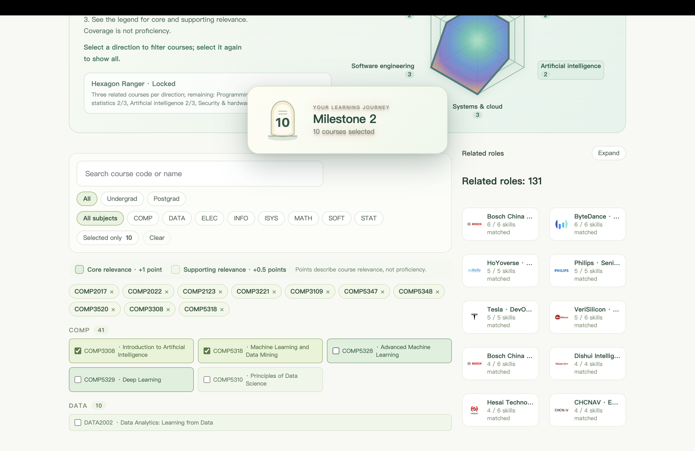

## Save roles for later

Save a role from its detail page and revisit it through **Saved roles**. Saved entries are stored locally in the current browser; they do not automatically sync to another browser or device.

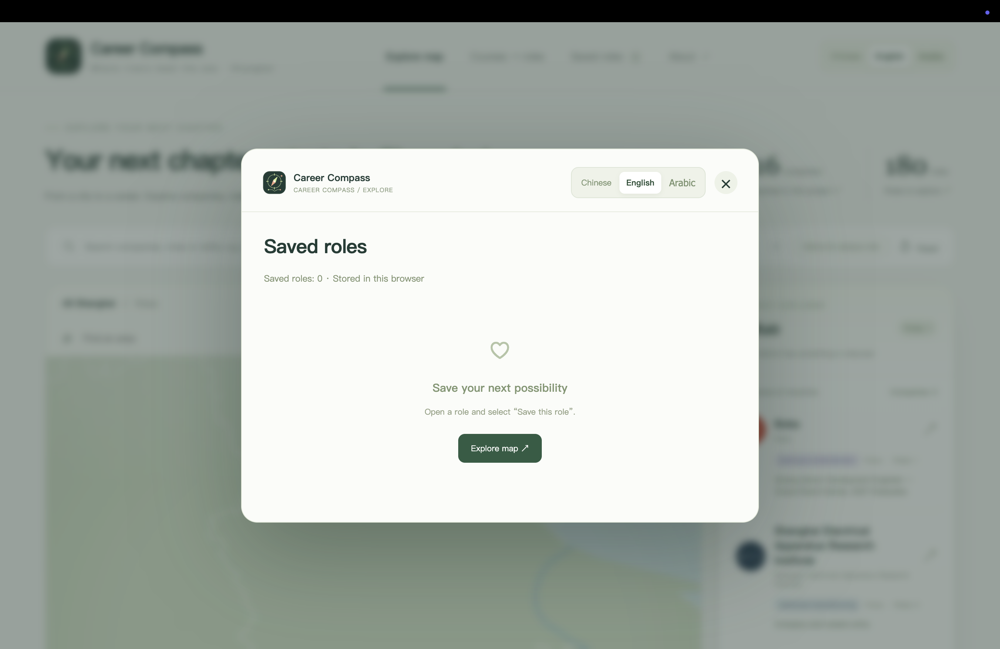

## Discover Dishui Lake

Click Dishui Lake on the map to focus on the lake and enjoy the fireworks Easter egg.

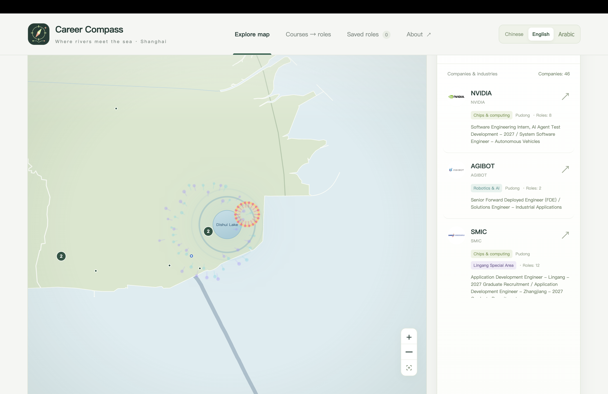
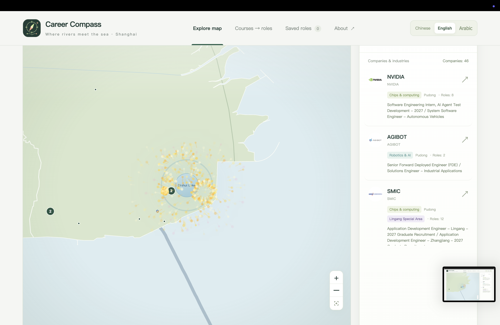

## Languages

The browser interface supports Chinese, English and Arabic. The terminal interface supports Chinese and English.

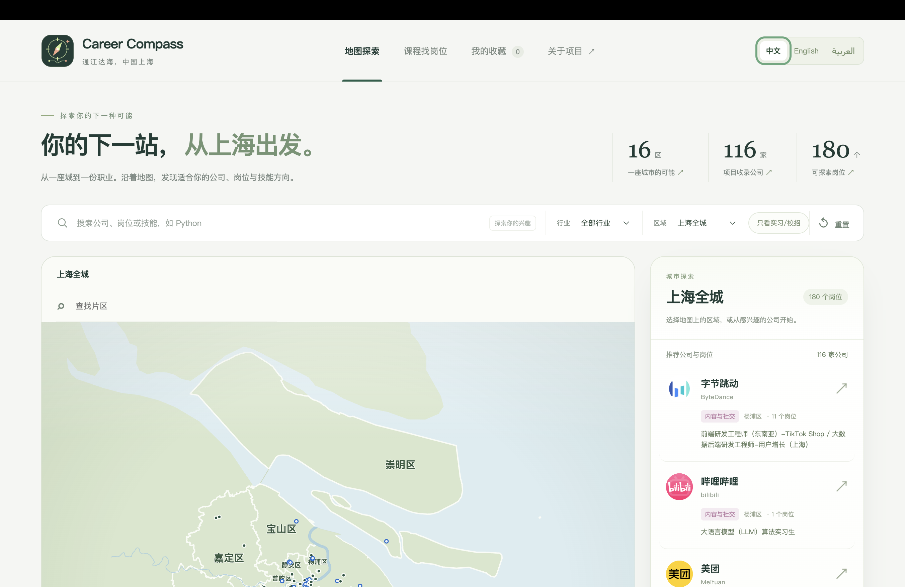
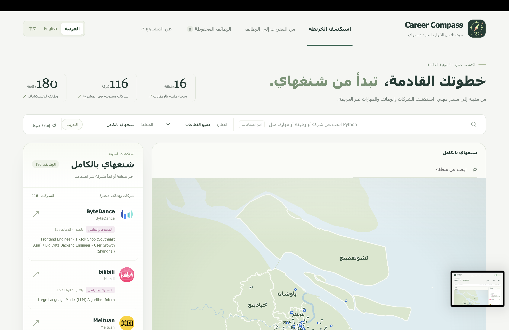

## Download and run

1. Choose **Code → Download ZIP** on this page and extract the archive.
2. Open a terminal in the extracted folder and run `python3 server.py` (Windows: `py server.py`).
3. The browser should open automatically. If it does not, visit http://127.0.0.1:8766/ on the same computer. Keep the terminal open while using the app.
4. To explore the terminal interface instead, run `python3 career_compass.py`.

Python 3.10 or later and a web browser are needed. No third-party Python packages are required. This local web application needs to run outside Ed. See [README.txt](README.txt) for detailed setup, code structure, limitations and AI acknowledgement. GitHub is an additional access route; code submission is through Ed.

**Data note:** Records were collected at different times and may be incomplete or out of date. A recorded role is not necessarily open. Check the original sources before relying on job, location or course information.
