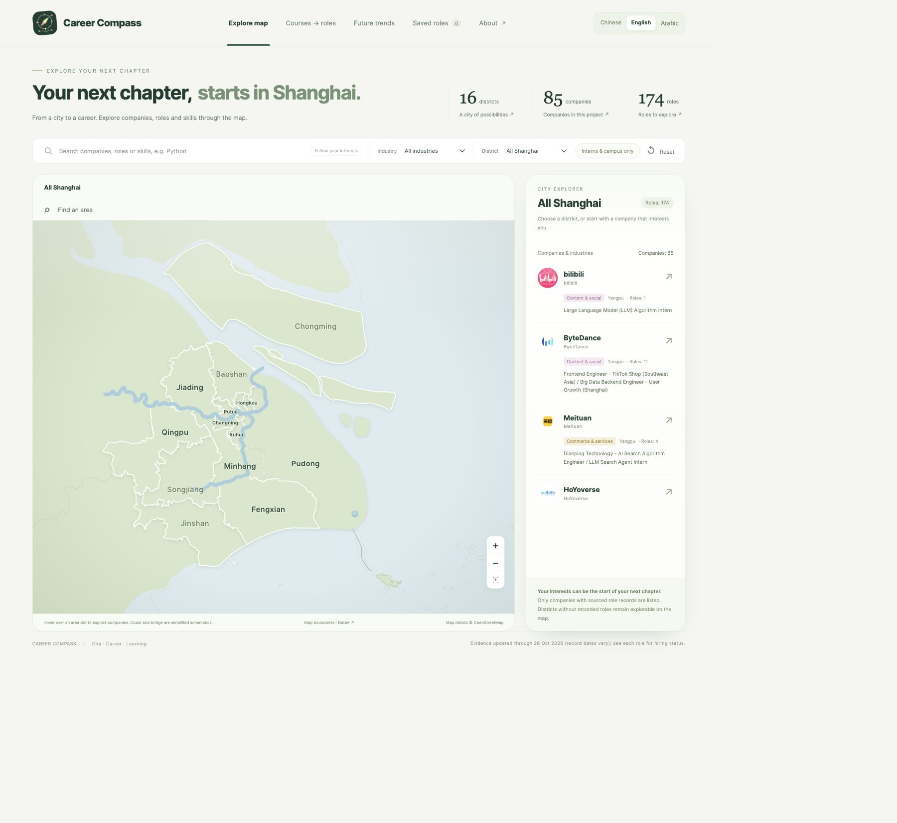
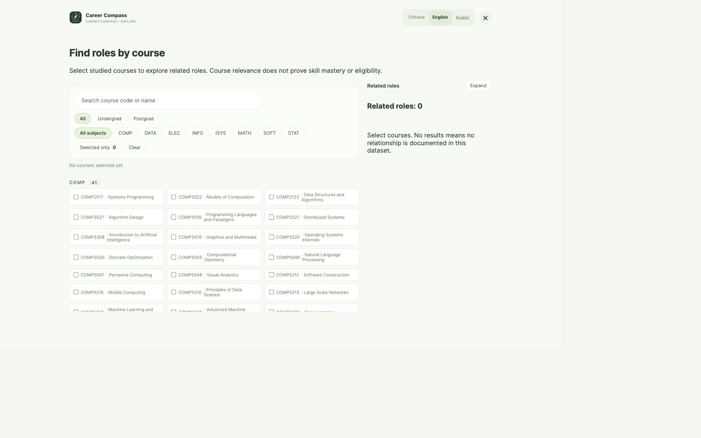

# Career Compass

Career Compass helps computing students explore Shanghai employers, recorded technology roles, and links between university courses and role skills. It combines Python analysis and a terminal interface with an interactive browser map.

## Download and run

1. Choose **Code → Download ZIP** on GitHub and extract the archive.
2. In the extracted folder, run `python3 server.py` (Windows: `py server.py`).
3. The browser should open automatically; otherwise visit http://127.0.0.1:8766/ on the same computer. Keep the terminal open.
4. For the terminal interface run `python3 career_compass.py`.

Python 3.10 or later and a browser are needed. No third-party Python packages are required. This local web application must be run outside Ed. See [README.txt](README.txt) for full instructions, limitations and AI acknowledgement. GitHub is an additional access route; code submission is through Ed.

## Explore

- Browse companies and recorded roles on the Shanghai map and follow source links.
- Select courses to explore related roles and the six-direction course profile.
- Click Dishui Lake for a fireworks Easter egg.
- Use the Python terminal interface to explore role skills and save a study plan.

Example captures from an earlier review; the current interface may differ:

Recorded jobs may have closed or changed. Verify vacancies, locations and course details with original sources. Course matches do not guarantee proficiency or eligibility.
